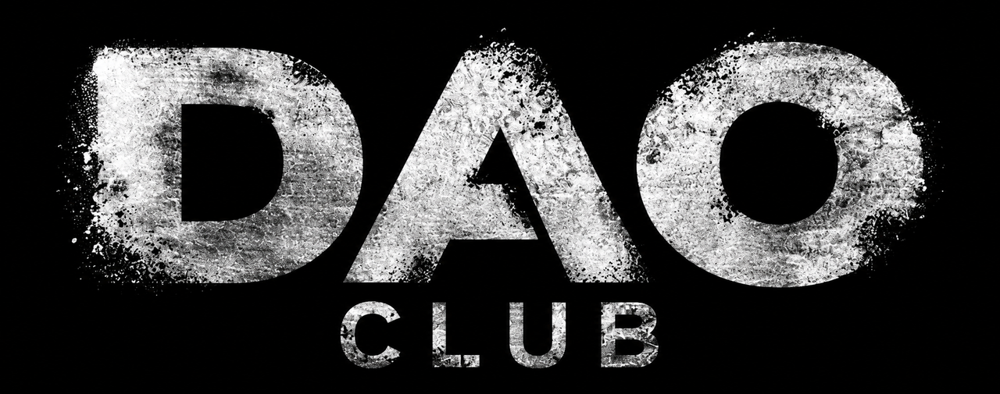

<p align="center">
  
</p>

<h3 align="center">ОБЪЕДИНЯЕМ ЛЮДЕЙ И ВОЗМОЖНОСТИ</h3>

<p align="center">
  <a href="https://daoclub.ru">Сайт</a> ·
  <a href="https://t.me/daotvoi">Telegram-канал</a> ·
  <a href="https://vk.com/daopro">ВКонтакте</a> ·
  <a href="https://t.me/gastellove">Написать основателю</a>
</p>

# Библиотека решений DAO CLUB

Готовые решения на ИИ, которые участники и резиденты DAO CLUB собрали, применили в своём бизнесе
и получили результат. Каждое решение — это скилл для ИИ-агента (Claude Code и совместимые) плюс
страница с описанием: какую задачу решает, как устроено, чем отличается от альтернатив.

Решение попадает сюда, только если его собрали, применили у себя и получили результат.

## Решения

| Решение | Задача | Скилл |
|---|---|---|
| [Разбор чужой механики](resheniya/daoreverse.md) | как устроен сайт, воронка, трекинг или приложение конкурента — с доказательствами и планом «как собрать у себя» | [`skills/daoreverse`](skills/daoreverse) |

## Как поставить скилл

Скажите своему ИИ-агенту:

> Поставь скилл `daoreverse` из https://github.com/daotut/club/tree/main/skills/daoreverse — сначала покажи, что встанет и куда, и ставь после моего «да».

Или вручную:

```bash
git clone https://github.com/daotut/club.git
cp -R club/skills/daoreverse ~/.claude/skills/
```

Дальше просто: «разбери, как устроено вот это» — и ссылка.

## Хотите так же у себя в бизнесе

Так устроен **DAO ИИнтенсив**: за несколько недель вы собираете систему на ИИ под свои процессы,
а готовые решения клуба ставите в неё одной фразой. Напишите в Telegram
[@gastellove](https://t.me/gastellove) слово ИНТЕНСИВ.
